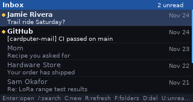
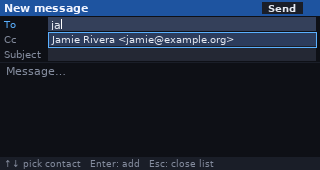
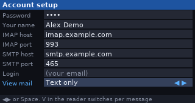

[](https://github.com/H4W9/CardputerZero_Mail/actions/workflows/build.yml)

# Email for Cardputer Zero

An email app for the M5Stack Cardputer Zero. Shows up in the launcher as Email.

 
 

## What it does

- Inbox, folders, search
- Read, reply, reply all, forward, delete
- Contact suggestions from people you've emailed
- Text only or full view with pictures (V switches)
- Save attachments and pictures to ~/Downloads
- Open links in a simple text browser, show them as a QR code, or download them
- Voice typing that works offline (optional, see below)
- Uses the whole 2.8in EXT display when DisplayMOD has one connected

Press Fn+H on any screen to see its keys.

## Install

Grab the .deb from [Releases](https://github.com/H4W9/CardputerZero_Mail/releases) (or the App Store once it's listed), copy it to the Cardputer and run:

```bash
sudo apt install ./czmail_0.4.1-m5stack1_all.deb
```

The app shows up in the launcher. The first time you open it, enter your email address and password. Server settings fill in by themselves for Gmail, Outlook, Yahoo, iCloud, Fastmail, GMX, AOL and Zoho. For anything else, type in your IMAP and SMTP servers.

Gmail, Yahoo, iCloud and Outlook need an app password instead of your normal one. For Gmail: turn on 2-Step Verification, then make one at https://myaccount.google.com/apppasswords

Your settings are saved in /root/.config/czmail/ (the launcher runs apps as root), readable by root only. The password is stored as plain text in that file.

## Keys

| Screen | Keys |
|---|---|
| Anywhere | Esc back, hold Esc to quit, Fn+H (or H, ?) help, Fn + F X Z C for arrows |
| Inbox | Enter open, / search, C new, R refresh, F folders, D delete, U unread, S settings |
| Email | R reply, A reply all, F forward, V view, I pictures, L links, T attachments, D delete |
| Writing | Tab next field, Ctrl+S send, Ctrl+Space voice typing, Ctrl+K contacts |
| Links | Enter open, Q QR code, S download |

## Voice typing

Uses Vosk with the small English model (about 45 MB). Everything stays on the device. Install it once:

```bash
sudo sh /usr/share/APPLaunch/apps/czmail/install_speech.sh
```

You need a microphone that shows up in `arecord -l`. While writing, press Ctrl+Space or Fn+Space, talk, then press Enter. Say "comma", "period", "question mark" or "new line" for punctuation.

## EXT display

If you have a 2.8in EXT display set up with DisplayMOD, Email opens on it at full size (320x240) and pauses the mirror while it runs. The built-in screen shows the same screen at its own size. When you close Email, the mirror comes back.

To keep Email on the built-in screen, set Screen to "Built-in only" in Settings (S). It takes effect the next time you open Email.

## Problems

Images or links that don't load are logged to /tmp/czmail.log. To test a single image:

```bash
cd /usr/share/APPLaunch/apps/czmail && python3 -m czmail --image-test <url>
```

## Building

Plain Python 3 with Pillow, no compiling needed.

```bash
python tools/build_deb.py                 # makes dist/czmail_<version>_all.deb on any OS
python -m czmail --demo                   # try it in a window on your PC (F1 = help)
python -m czmail --demo --ext             # same, with the EXT display layout
python -m unittest discover -s tests      # tests
```

It also builds with the CardputerZero AppBuilder (packaging/meta.env, build.sh, stage.sh).

GitHub Actions runs the tests and builds the .deb on every push (download it from the run's artifacts). To make a release, bump the version in `packaging/meta.env`, `czmail/__init__.py` and `app-builder.json`, then push a tag `v<version>`, or run the Build workflow by hand with "Draft a release" ticked. Either way you get a draft release with the .deb attached, to check and publish.

## License

MIT
